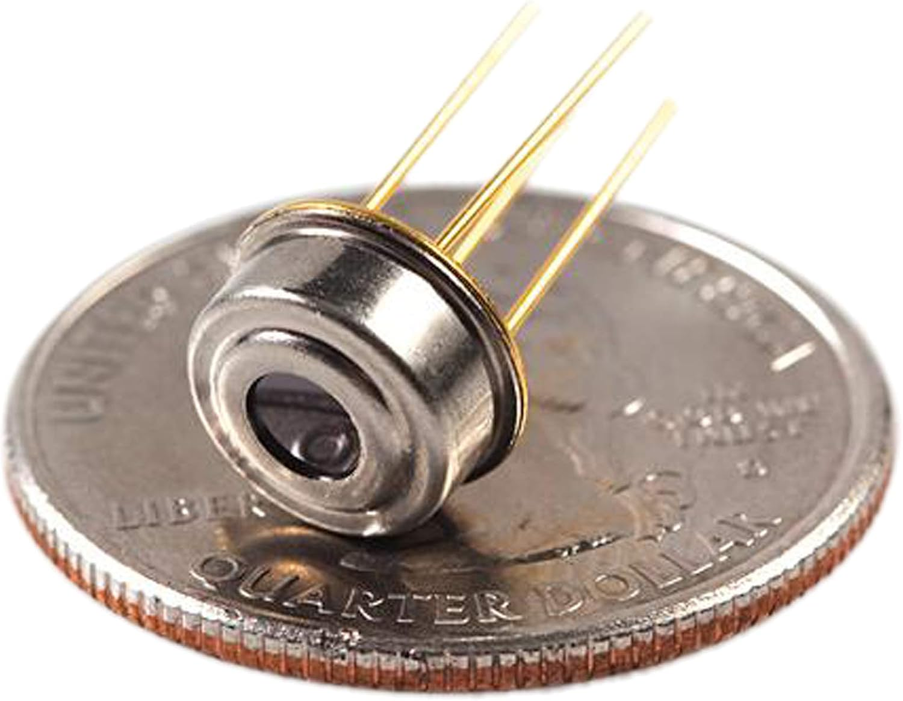
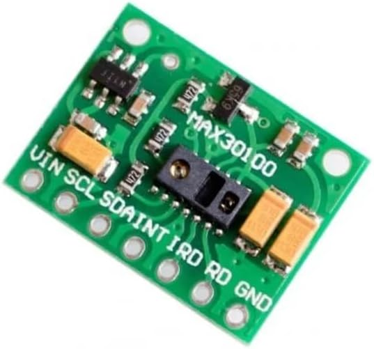
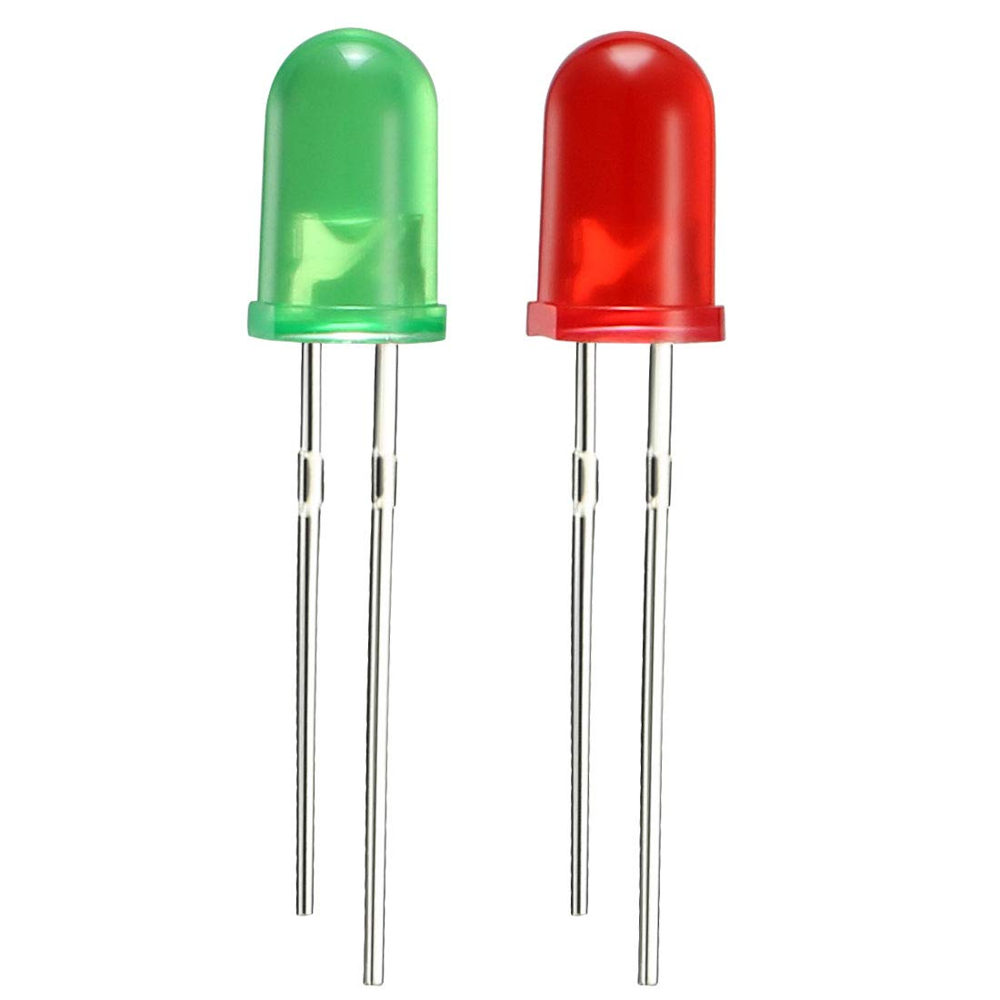
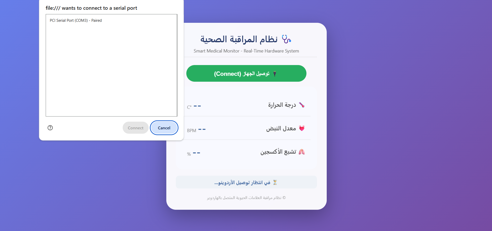

# Smart-Patient-Monitor
# 🩺 Smart Patient Monitor (Remote Health Monitoring System)

An IoT-based real-time health monitoring system designed to measure vital signs—body temperature, heart rate (BPM), and blood oxygen saturation ($SpO_2$)—and display them live on a web dashboard via the **Web Serial API**, eliminating the need for an external LCD screen.

## 🌟 Key Features
- **Real-Time Vital Signs Tracking:** Continuous monitoring of temperature, pulse rate, and oxygen levels.
- **Direct Browser Integration:** Uses the native **Web Serial API** to stream JSON data directly from Arduino to the web interface without requiring a backend server or external plugins.
- **Automated Alert System:** Visual (Green/Red LEDs) and audible (Buzzer) alerts trigger automatically if readings exceed normal medical thresholds.
- **Responsive Arabic UI:** Clean, modern, and user-friendly dashboard with instant health status evaluation.

---

## 🛠️ Hardware Components
* **Microcontroller:** Arduino Uno
* **Temperature Sensor:** MLX90614 (Non-Contact Infrared Temperature Sensor)
* **Pulse & Oxygen Sensor:** MAX30102 / MAX30100 (Pulse Oximeter and Heart-Rate Sensor)
* **Indicators & Alerts:** 
  * Green LED (Normal Status)
  * Red LED (Critical Alert)
  * Active Buzzer (Audible Alarm)
* **Prototyping:** Breadboard and Jumper Wires

---

## 💻 Software & Technologies
* **Embedded C++ (Arduino IDE):** For sensor data acquisition, I2C communication, and alert logic.
* **HTML5 & CSS3:** For building the responsive medical dashboard UI.
* **JavaScript (ES6+ & Web Serial API):** For reading serial streams, parsing JSON packets, and dynamically updating the DOM.

---

## 🔌 Circuit Wiring Diagram

Both sensors communicate via the **I2C protocol** and share the same `SDA` and `SCL` lines in parallel on the breadboard:

| Component | Pin Name | Arduino Uno Pin | Notes |
| :--- | :--- | :--- | :--- |
| **MLX90614** | VIN / VCC | `5V` (or `3.3V`) | Power Supply |
| | GND | `GND` | Common Ground |
| | SDA | `A4` | I2C Data Line (Shared) |
| | SCL | `A5` | I2C Clock Line (Shared) |
| **MAX30102** | VIN / VCC | `3.3V` (or `5V`) | Power Supply |
| | GND | `GND` | Common Ground |
| | SDA | `A4` | I2C Data Line (Shared) |
| | SCL | `A5` | I2C Clock Line (Shared) |
| **Green LED** | Anode (+) | `D6` | Connect via 220Ω resistor |
| **Red LED** | Anode (+) | `D7` | Connect via 220Ω resistor |
| **Buzzer** | Positive (+) | `D8` | Audible Alert Output |

---

## 📸 Sensors & Hardware Preview

| MLX90614 (Temperature Sensor) | MAX30102 (Pulse & Oximeter) |
| :---: | :---: |
|  |  |
| Non-contact infrared sensor for measuring body temperature. | Optical sensor for measuring heart rate (BPM) and $SpO_2$. |

| LEDs | Active Buzzer |
| :---: | :---: |
|  |  |
| Visual status indicators (Normal / Alert). | Audible alarm for critical readings. |

### Complete Circuit & Web Dashboard

| Web Dashboard Interface |
 | :---: |
 |  |

---

## 🚀 How to Run
1. Connect the sensors, LEDs, and buzzer to the Arduino Uno according to the wiring table above.
2. Upload `arduino_code.ino` to your Arduino board using the Arduino IDE (ensure the Serial Monitor is closed after uploading).
3. Open `index.html` in a Chromium-based browser (**Google Chrome** or **Microsoft Edge**).
4. Click **Connect (توصيل الجهاز)**, select the corresponding `COM` port, and start monitoring.
